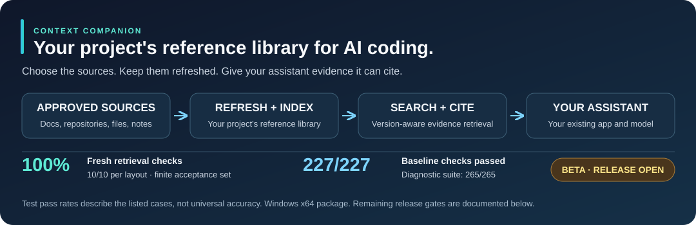
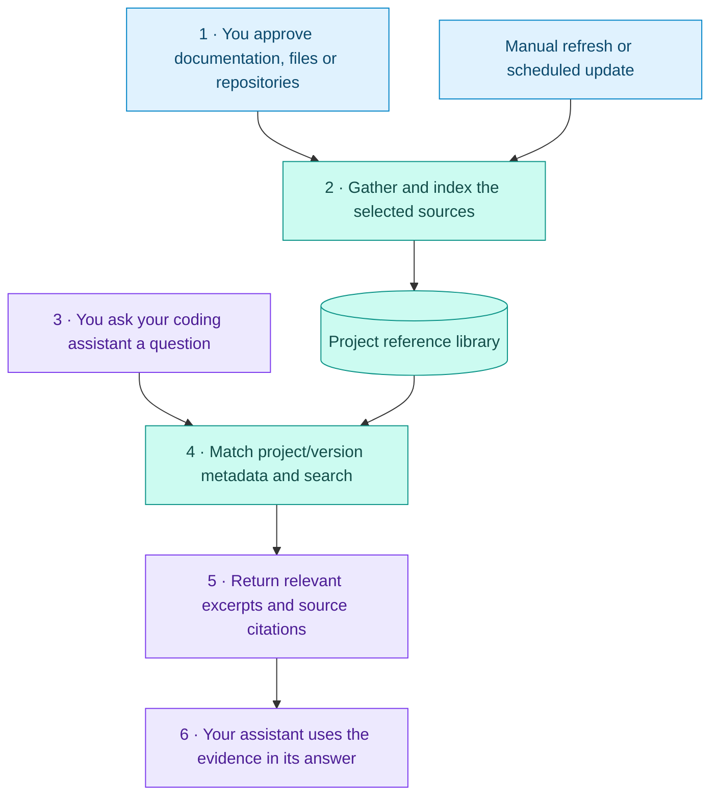

# Context Companion

**Give your AI coding assistant the right project references, keep them refreshed, and see where its evidence came from.**



[Get started](#get-started-on-windows) · [What it does](#what-you-get) · [How it works](#how-it-works) · [Results](#measured-results) · [Release readiness](#release-readiness)

## What is it?

Context Companion is a **local reference library for your AI coding assistant**. Add documentation websites, public Git repositories, local files or team notes. It indexes those sources, refreshes them when configured, and gives your assistant relevant excerpts with citations.

**Why use it?** When a project depends on a particular library version or internal procedure, the assistant can consult those references instead of relying only on its training or repeatedly asking you to paste documentation. Your existing AI app and model still do the coding and answering.

| At a glance | Current position |
|---|---|
| Package | **1.1.0-rc.1 · Windows x64 · beta/release candidate** |
| Retrieval | **🟢 Phase 1's defined retrieval gate passed** |
| Full release | **🔴 Not accepted yet — five verification phases remain** |
| Hardware | No mandatory GPU, Docker, WSL or paid embedding service |
| Data | Local indexes and memory; your AI host may send retrieved excerpts to its model provider |

## What you get

Ranked by the main practical benefits for a coding workflow. This is an editorial priority order, not a benchmark ranking against other products.

| Rank | Capability | What it helps you do |
|---:|---|---|
| **1** | **Find project documentation** | Ask a concrete question and retrieve relevant passages from the sources you approved. |
| **2** | **Use the intended versions** | Match library/version, language and platform requirements against source metadata, reducing accidental mixing of incompatible references. |
| **3** | **Keep the library current** | Refresh sources manually or on a schedule, such as every 24 hours, while the controller runs. |
| **4** | **Check the evidence** | Inspect excerpts, original source locations, version information and timestamps before trusting a suggestion. |
| **5** | **Retain project knowledge** | Store reviewable findings, decisions and failed approaches so later sessions can retrieve them. Memory remains advisory. |
| **6** | **Navigate existing code** | Use the project-bound, read-only Serena bridge for supported definitions and references. |
| **7** | **Reduce repeated context setup** | Supported Codex hooks retrieve context at session start and before substantive prompts; other hosts can request it through MCP tools. |

**Supported inputs:** approved public documentation sites, public HTTPS Git repositories, local folders/files, uploaded documents and pasted notes. Document support varies; broad fidelity and scanned OCR remain under verification.

## How it works



**Refresh and search are different:** refreshing updates the stored library; asking a question searches the current index. A search does not automatically refresh a source. Scheduled updates require the controller to be running.

**Versions are explicit:** supported manifests and lockfiles help identify project requirements. You still choose a matching documentation URL, repository tag/commit or local folder. A version label does not prove the content matches, and refreshing a pinned commit keeps it pinned. The service does not automatically discover every correct source.

### A professional example

| Step | Example |
|---|---|
| **Supply references** | Attach Python 3.12 documentation and your team's service architecture guide. |
| **Ask a question** | “Which queue API fits this worker design? Use the Python 3.12 references and cite the relevant limitations.” |
| **Retrieve evidence** | Context Companion filters eligible sources and returns relevant passages with their original citations. |
| **Make a decision** | Your assistant uses those passages to explain a proposal. You still verify the code and its behavior. |

## Measured results

**These percentages are test pass rates for the listed cases. They are not an overall accuracy score, a performance guarantee or a comparison with other products.**

| Verification | Passed / executed | Pass rate | Evidence scope |
|---|---:|---:|---|
| Fresh version-specific retrieval acceptance | **10/10 per layout** | **🟢 100%** | Frozen Python 3.12.8 / Node.js 24.21.0 tasks; citations, source hashes, version controls and unsupported questions. |
| Previously failing professional retrieval set | **13/13 per layout** | **🟢 100%** | Unchanged replay; the original result was **11/13 (84.6%)**. |
| Broader known retrieval regressions | **354/354** across both layouts | **🟢 100%** | Retained development and previously exposed holdout cases; regression evidence. |
| Everyday documentation replay | **12/12** | **🟢 100%** | Unchanged questions and criteria; original result **9/12 (75%)**. |
| Keyword-only abstention replay | **3/3** | **🟢 100%** | Known support/unsupported controls; original result **2/3 (66.7%)**. |
| Controller baseline | **227/227** | **🟢 100%** | Automated regression checks. |
| Full diagnostic suite | **265/265** | **🟢 100%** | Includes the baseline; do not add these suite counts together. |

**Build: PASS.** Windows and Ubuntu controller CI passed for the Phase 1 publication. “Both layouts” means grouping documents into sources versus using a source per file. The fresh checks were author-generated and frozen before execution; they are not an external blind evaluation. Previously exposed cases are labelled as replays.

Earlier bounded checks also demonstrated Codex automatic context delivery, a correlated reused-GUI turn, local model/API retrieval, five document-format fixtures and a fresh Windows install/runtime-removal check. Those checks ran on the candidates recorded in the report; they do not certify every session, document or later release gate.

[Read the full results and historical failures](docs/TEST_RESULTS.md) · [Inspect the Phase 1 evidence summary](evidence/phase1-retrieval-completion.json)

## Release readiness

**🟢 Passed within stated scope → 🟡 Partial evidence → 🔴 Open release gate**

**1 of 6 planned release phases is closed: 16.7% by phase count.** This is a checklist measure, **not** the percentage of features built, engineering effort completed or overall product quality. The phases differ in size.

| Phase | What it proves | Status |
|---:|---|---|
| **1** | Retrieve supported documentation and reject the tested unsupported requests | **🟢 Complete for the defined finite gate** |
| **2** | Reliable delivery, refresh and memory across repeated use, restarts and failures | **🟡 Bounded earlier checks; phase not started** |
| **3** | Representative document fidelity and the actual scope of scanned OCR | **🟡 Five format fixtures passed; phase not started** |
| **4** | MCP searches and cited answers inside native LM Studio | **🟡 API/SDK proof exists; native phase not started** |
| **5** | Exact release payload, dependency/model license and notice clearance | **🟡 Partial provenance exists; phase not started** |
| **6** | Final installation, upgrade, backup/restore, normal-use and uninstall rehearsal | **🔴 Final gate open; phase not started** |

**Full release acceptance remains FAIL.** Existing successful checks do not close these remaining gates. Original tests, assertions and failed receipts are preserved; earlier failures were not rewritten into passes. [See the phased completion plan](docs/RELEASE_COMPLETION_PLAN.md).

## Which assistants and platforms?

| Environment | What is available | Limit |
|---|---|---|
| **Windows x64 + Codex** | Managed connection, project instructions, MCP tools and automatic hooks | Scoped live proof; continuous reliability remains open. |
| **Other MCP hosts** | Project-bound local stdio tools for searching, reading and memory | Configure and verify each host; automatic injection needs host-specific orchestration. |
| **LM Studio** | Scoped Nomic embedding and local-chat API/MCP checks | Native GUI setup and recovery remain a release gate. |
| **Linux** | Ubuntu controller build/regression CI | No supported Linux installer or full installed-workflow proof yet. |
| **Pi + Gufo** | Plausible MCP/model-provider combination | Not integrated or verified end to end in this project. |

MCP is the connection that lets an assistant request tools. Context Companion uses **local stdio MCP**, not its internal HTTP API as a remote MCP endpoint. Chat models and embedding models serve different roles. [Connection examples and verification](docs/MCP.md).

## Get started on Windows

1. **Download or clone** this repository. Extract the whole folder to a permanent location such as `C:\ContextCompanion`; compiled `dist` files are included.
2. **Run `Install.bat`** on Windows x64. Internet access is needed for the isolated dependencies and initial checks.
3. **Add your project** in the dashboard, then attach a small set of relevant documentation sources.
4. **Confirm indexing** and inspect a real passage in **Search & evidence**. Set a refresh interval if wanted; zero means manual refresh.
5. **Connect your assistant.** For Codex, review/trust its managed configuration and hooks, then start a fresh chat. Use `Start.bat` on later runs.

Optional public Git imports require Git for Windows in `PATH`. For a changed local document, click **Refresh / retry**, confirm **Indexed** and a recent **Last good index**, then search for the changed passage.

| Daily task | Control |
|---|---|
| Start / stop | `Start.bat` / `Stop.bat` |
| Inspect problems / verify dependencies | `Diagnose.bat` / `Verify-Installation.bat` |
| Run regression tests | `Run-Tests.bat` |
| Verify actual model/MCP use | `Verify-Codex.bat` — explicit model-use confirmation |
| Back up / restore / uninstall | `Backup.bat` / `Restore-Backup.bat` / `Uninstall.bat` — review retention options |

[Installation and troubleshooting](docs/INSTALLATION.md) · [Usage walkthrough](docs/USAGE.md)

<details>
<summary><strong>Architecture and contributor checks</strong></summary>

The TypeScript controller and dashboard manage projects, permissions, jobs, refreshes and memory. **Grounded Docs** owns conversion, chunking and SQLite FTS/vector storage. The optional worker supplies local CPU or existing loopback embeddings. **Serena** supplies project-bound, read-only code navigation.

The compiled controller has no production npm dependencies. With compatible Node (the Windows installer pins 24.21.0), install the pinned development dependencies and run:

```powershell
npm ci --ignore-scripts
npm run build
npm test
npm run test:diagnostic
```

Keep `dist` synchronized with `src`. Controlled tests do not substitute for actual upstream, native Windows or AI-host verification. Preserved research checks remain available through `npm run test:research`.

[Test suites](docs/TEST_SUITES.md) · [Public status](docs/PUBLIC_STATUS.md)

</details>

## Privacy and license

Application data defaults to `%LOCALAPPDATA%\ContextCompanion`, outside this repository. **Do not upload that directory:** it can contain private indexes, tokens, memories, logs, backups, runtimes and model caches. Source approval and credential detection are bounded safeguards. Local storage does not prevent your AI host from sending excerpts to its provider.

Original Context Companion code is **MIT licensed**. Dependencies, model weights and upstream documentation retain their own terms. The publication excludes private raw receipts, indexed user documents, runtimes and model weights; the exact payload is recorded in `release-manifest.json`.

[Security and privacy](docs/SECURITY.md) · [Dependencies](docs/DEPENDENCIES.md) · [Third-party notices](THIRD_PARTY_NOTICES.md) · [License](LICENSE)
